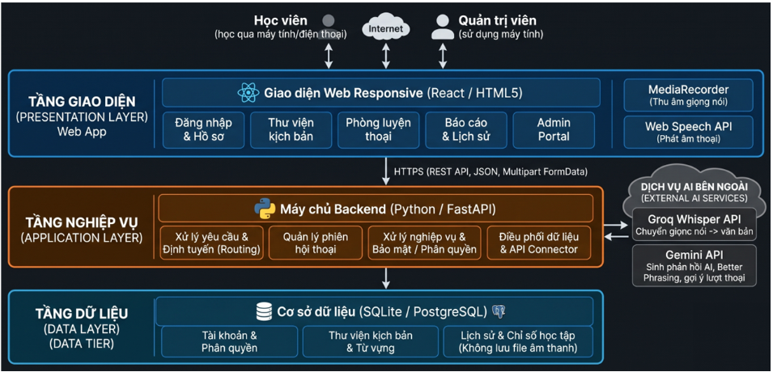

**ĐẠI HỌC QUỐC GIA THÀNH PHỐ HỒ CHÍ MINH**  
**TRƯỜNG ĐẠI HỌC KHOA HỌC TỰ NHIÊN**  
**KHOA CÔNG NGHỆ THÔNG TIN**  
**BỘ MÔN CÔNG NGHỆ PHẦN MỀM**  

━━━━━━━━━━━━━━━━━━━ ◆ ━━━━━━━━━━━━━━━━━━━

**ĐỀ CƯƠNG ĐỒ ÁN MÔN HỌC**  
**PROJECT PROPOSAL**  

| ĐỀ TÀI: HỆ THỐNG HỖ TRỢ LUYỆN HỘI THOẠI TIẾNG ANH NHẬP VAI THEO NGỮ CẢNH TÍCH HỢP TRỢ LÝ AI |
| :---: |

| Môn học: | Nhập môn Công nghệ Phần mềm |
| :---- | :---- |
| **Giảng viên hướng dẫn:** | **ThS. Ngô Ngọc Đăng Khoa** |
| **Nhóm sinh viên thực hiện:** | **Nhóm 4 thành viên** |
| **Học kỳ / Năm học:** | Học kỳ 1 – Năm học 2026-2027 |

**THÀNH PHỐ HỒ CHÍ MINH, NĂM 2026**

---

**MỤC LỤC**

| 1. Bảng đánh giá thành viên | 2 |
| :---- | :---- |
| **2. Phát biểu bài toán sơ lược** | **3** |
| **3. Giải pháp đề xuất** | **4** |
| &nbsp;&nbsp;&nbsp;&nbsp;3.1. Phần mềm | 4 |
| &nbsp;&nbsp;&nbsp;&nbsp;&nbsp;&nbsp;&nbsp;&nbsp;3.1.1. Danh sách các chức năng phần mềm | 4 |
| &nbsp;&nbsp;&nbsp;&nbsp;&nbsp;&nbsp;&nbsp;&nbsp;3.1.2. Kiến trúc tổng thể phần mềm | 6 |
| &nbsp;&nbsp;&nbsp;&nbsp;3.2. Phần cứng | 6 |
| **4. Kế hoạch phát triển** | **6** |
| &nbsp;&nbsp;&nbsp;&nbsp;4.1. Phân tích yêu cầu | 7 |
| &nbsp;&nbsp;&nbsp;&nbsp;4.2. Thiết kế phần mềm | 7 |
| &nbsp;&nbsp;&nbsp;&nbsp;4.3. Cài đặt (implement) phần mềm | 8 |
| &nbsp;&nbsp;&nbsp;&nbsp;4.4. Kiểm thử phần mềm | 9 |
| &nbsp;&nbsp;&nbsp;&nbsp;4.5. Triển khai, bảo trì | 10 |
| &nbsp;&nbsp;&nbsp;&nbsp;4.6. Lịch trình triển khai theo Scrum | 10 |
| **5. Kế hoạch nhân sự & chi phí** | **13** |
| &nbsp;&nbsp;&nbsp;&nbsp;5.1. Kế hoạch nhân sự | 13 |
| &nbsp;&nbsp;&nbsp;&nbsp;&nbsp;&nbsp;&nbsp;&nbsp;5.1.1. Cơ cấu nhân sự và trách nhiệm | 13 |
| &nbsp;&nbsp;&nbsp;&nbsp;&nbsp;&nbsp;&nbsp;&nbsp;5.1.2. Phân bổ nhân sự theo giai đoạn | 14 |
| &nbsp;&nbsp;&nbsp;&nbsp;**5.2. Kế hoạch chi phí** | **15** |
| &nbsp;&nbsp;&nbsp;&nbsp;&nbsp;&nbsp;&nbsp;&nbsp;5.2.1. Bảng dự toán chi phí | 15 |
| &nbsp;&nbsp;&nbsp;&nbsp;&nbsp;&nbsp;&nbsp;&nbsp;5.2.2. Biện pháp kiểm soát chi phí | 16 |
| &nbsp;&nbsp;&nbsp;&nbsp;&nbsp;&nbsp;&nbsp;&nbsp;5.2.3. Kết luận | 16 |

---

# **1. Bảng đánh giá thành viên**

| MSSV | Họ Tên | Vai trò | % đóng góp (tối đa 100%) | Chữ ký |
| :---: | :---: | :---: | :---: | :---: |
| 19120501 | Nguyễn Nhật Hảo | Scrum Master | 100% | Đã ký |
| 19120627 | Hồ Minh Quân | Frontend Developer | 100% | Đã ký |
| 24120263 | Đỗ Ngọc Gia Bảo | Product Owner | 100% | Đã ký |
| 24120467 | Phạm Đức Toàn | Backend Developer | 100% | Đã ký |

---

# **2. Phát biểu bài toán sơ lược**

Hiện nay, nhiều sinh viên có nền tảng từ vựng và ngữ pháp tiếng Anh nhưng vẫn gặp khó khăn khi giao tiếp do thiếu môi trường thực hành, ngại mắc lỗi và hạn chế về chi phí học tập. Ứng dụng được đề xuất nhằm hỗ trợ người học luyện hội thoại tiếng Anh thông qua các tình huống thực tế với trợ lý trí tuệ nhân tạo (AI), giúp rèn luyện phản xạ giao tiếp và cải thiện cách diễn đạt. Hệ thống hoạt động trên nền tảng Web, tập trung vào năm phân hệ chức năng chính:

* **Phân hệ Quản lý tài khoản và Hồ sơ học tập:** Cho phép người dùng đăng ký, đăng nhập, quản lý thông tin cá nhân và xem lịch sử luyện tập. Hệ thống phân quyền giữa học viên và quản trị viên để kiểm soát quyền truy cập.
* **Phân hệ Thư viện kịch bản tình huống và Từ vựng ngữ cảnh:** Cung cấp các kịch bản giao tiếp thuộc chủ đề đời sống và nghề nghiệp, như gọi món tại quán cà phê hoặc phỏng vấn thực tập. Người học có thể tìm kiếm kịch bản, xem bối cảnh, vai diễn, mục tiêu giao tiếp và tra cứu từ vựng kèm nghĩa tiếng Việt, phiên âm và câu ví dụ.
* **Phân hệ Phòng luyện thoại tương tác giọng nói theo lượt (Turn-based Voice Room):** Cho phép học viên lựa chọn kịch bản và hội thoại với AI bằng cách bấm bắt đầu ghi âm, bấm dừng để gửi câu nói và nhận phản hồi. Hệ thống chuyển giọng nói thành văn bản thông qua Groq Whisper API, sau đó sử dụng Gemini API để tạo câu đối đáp theo ngữ cảnh, phát hiện lỗi diễn đạt và đề xuất cách nói tự nhiên hơn (Better Phrasing), đồng thời cung cấp các câu gợi ý cho lượt tiếp theo. Nội dung được hiển thị dưới dạng phụ đề và có thể phát âm thanh bằng chức năng tổng hợp giọng nói trên trình duyệt khi thiết bị hỗ trợ.
* **Phân hệ Báo cáo sau phiên học và Lịch sử học tập:** Tổng hợp thời lượng luyện tập, số lượt hội thoại, mức độ hoàn thành mục tiêu và các câu nói đã được góp ý. Dữ liệu được lưu dưới dạng văn bản và chỉ số học tập, giúp người dùng xem lại kết quả và theo dõi quá trình rèn luyện.
* **Phân hệ Quản trị nội dung (Admin Portal):** Cho phép quản trị viên thêm, xem, chỉnh sửa và xóa các kịch bản, chủ đề và bộ từ vựng mẫu, phục vụ việc cập nhật và mở rộng nội dung học tập.

Về môi trường hoạt động và triển khai, đây là ứng dụng Web tương thích với các trình duyệt hiện đại hỗ trợ HTML5 và chức năng thu âm. Hệ thống áp dụng kiến trúc ba tầng (3-Tier Architecture), gồm tầng giao diện, tầng xử lý nghiệp vụ và tầng dữ liệu. Giao diện Web sử dụng MediaRecorder để thu âm; máy chủ được xây dựng bằng Python với FastAPI để xử lý nghiệp vụ và kết nối các dịch vụ AI; cơ sở dữ liệu SQLite hoặc PostgreSQL được sử dụng để lưu tài khoản, kịch bản và lịch sử học tập. Hệ thống không lưu tệp âm thanh sau khi xử lý nhằm hạn chế nhu cầu lưu trữ dữ liệu.

Dự án ưu tiên sử dụng các dịch vụ có gói miễn phí và giới hạn phạm vi chức năng ở mức phù hợp. Hệ thống có cơ chế xử lý lỗi khi API vượt hạn mức hoặc gặp sự cố, đồng thời cung cấp các kịch bản hội thoại mẫu dự phòng phục vụ kiểm thử. Chất lượng phần mềm được đánh giá thông qua kiểm thử chức năng, kiểm thử các tình huống lỗi và thực nghiệm khả năng nhận diện giọng nói, độ trễ phản hồi trên các kịch bản mẫu.

---

# **3. Giải pháp đề xuất**

## **3.1. Phần mềm**

### **3.1.1. Danh sách các chức năng phần mềm**

Dựa trên nhu cầu luyện giao tiếp tiếng Anh của sinh viên, hệ thống được xây dựng nhằm cung cấp môi trường hội thoại nhập vai với trợ lý AI, hỗ trợ sửa lỗi và theo dõi tiến bộ học tập. Các chức năng được xác định thông qua câu chuyện người dùng như sau:

| Mã | Vai trò | Câu chuyện người dùng |
| :---: | :---: | ----- |
| US01 | Học viên | Là học viên, tôi muốn đăng ký và đăng nhập để quản lý thông tin và lịch sử học tập của mình. |
| US02 | Học viên | Là học viên, tôi muốn tìm kiếm và lựa chọn kịch bản giao tiếp phù hợp để luyện tập theo nhu cầu. |
| US03 | Học viên | Là học viên, tôi muốn tra cứu từ vựng và mẫu câu theo tình huống để chuẩn bị trước khi hội thoại. |
| US04 | Học viên | Là học viên, tôi muốn nói chuyện với AI bằng giọng nói và nhận phản hồi sửa lỗi để cải thiện khả năng giao tiếp. |
| US05 | Học viên | Là học viên, tôi muốn xem báo cáo và lịch sử luyện tập để theo dõi sự tiến bộ của bản thân. |
| US06 | Quản trị viên | Là quản trị viên, tôi muốn quản lý kịch bản và từ vựng để cập nhật nội dung cho hệ thống. |

Từ các câu chuyện người dùng trên, hệ thống cung cấp các nhóm chức năng sau:

* **Quản lý tài khoản:** Đăng ký, đăng nhập, đăng xuất, quản lý thông tin cá nhân và phân quyền giữa học viên với quản trị viên.
* **Quản lý thư viện tình huống:** Hiển thị, tìm kiếm và xem chi tiết các kịch bản giao tiếp; cung cấp bối cảnh, vai diễn, mục tiêu giao tiếp, từ vựng và mẫu câu liên quan.
* **Luyện hội thoại với AI:** Thu âm theo từng lượt bằng thao tác bắt đầu và dừng ghi âm; chuyển giọng nói thành văn bản, tạo câu đối đáp phù hợp với kịch bản, hiển thị phụ đề và phát âm thanh phản hồi khi trình duyệt hỗ trợ.
* **Sửa lỗi và gợi ý diễn đạt:** Phân tích câu nói của học viên để đề xuất cách diễn đạt tự nhiên hơn (Better Phrasing), kèm các câu gợi ý cho lượt hội thoại tiếp theo.
* **Báo cáo và lịch sử học tập:** Lưu và hiển thị lịch sử hội thoại, thời lượng luyện tập, số lượt trao đổi, mục tiêu hoàn thành và các câu đã được góp ý.
* **Quản trị nội dung:** Cho phép quản trị viên thêm, xem, chỉnh sửa và xóa kịch bản, chủ đề và bộ từ vựng mẫu.

**Các quy định nghiệp vụ chính:**

* Học viên phải đăng nhập để sử dụng các chức năng lưu lịch sử học tập; chỉ quản trị viên mới được phép quản lý nội dung hệ thống.
* Mỗi phiên luyện tập gắn với một kịch bản cụ thể. Nội dung phản hồi của AI phải dựa trên bối cảnh và vai diễn đã chọn.
* Mỗi lượt nói của học viên được xử lý theo quy trình nhận diện giọng nói, sinh phản hồi và gợi ý cải thiện. Hệ thống ưu tiên gộp các tác vụ xử lý ngôn ngữ vào một yêu cầu Gemini cho mỗi lượt.
* Kết quả phiên học được lưu dưới dạng văn bản và chỉ số học tập; tệp âm thanh không được lưu trữ lâu dài sau khi xử lý.
* Khi dịch vụ AI hoặc kết nối mạng gặp sự cố, hệ thống thông báo trạng thái và sử dụng dữ liệu hội thoại mẫu dự phòng trong phạm vi hỗ trợ, không cam kết duy trì hội thoại AI trực tuyến khi mất kết nối.

### **3.1.2. Kiến trúc tổng thể phần mềm**

Ứng dụng được thiết kế theo kiến trúc ba tầng (3-Tier Architecture), gồm tầng giao diện người dùng, tầng xử lý nghiệp vụ và tầng dữ liệu. Kiến trúc này giúp phân tách trách nhiệm, thuận tiện cho phát triển, kiểm thử và bảo trì.

* **Tầng giao diện (Presentation Layer):** Ứng dụng Web responsive cung cấp giao diện đăng nhập, thư viện tình huống, phòng luyện thoại và báo cáo học tập. MediaRecorder được sử dụng để thu âm theo từng lượt; Web Speech API hỗ trợ phát âm thanh phản hồi trên trình duyệt khi khả dụng.
* **Tầng xử lý nghiệp vụ (Application Layer):** Backend sử dụng Python và FastAPI để xử lý yêu cầu, kiểm tra quyền truy cập, quản lý phiên hội thoại và kết nối dịch vụ AI. Groq Whisper API đảm nhiệm chuyển giọng nói thành văn bản; Gemini API tạo phản hồi nhập vai, sửa lỗi và gợi ý câu nói. Backend đồng thời xử lý ngoại lệ và cung cấp phương án hội thoại mẫu dự phòng.
* **Tầng dữ liệu (Data Layer):** SQLite hoặc PostgreSQL lưu trữ tài khoản, vai trò, kịch bản, từ vựng, lịch sử hội thoại và kết quả luyện tập. Hệ thống chỉ lưu dữ liệu văn bản và chỉ số học tập cần thiết, không lưu tệp âm thanh sau xử lý.

Các tầng giao tiếp thông qua API với dữ liệu trao đổi theo định dạng JSON; riêng dữ liệu âm thanh được gửi dưới dạng tệp ghi âm đến backend để xử lý. Các khóa API được quản lý ở phía máy chủ, không công khai trong mã nguồn giao diện.

## **3.2. Phần cứng**

Ứng dụng không yêu cầu thiết bị chuyên dụng. Các yêu cầu phần cứng dự kiến gồm:

* **Máy phát triển:** Máy tính cá nhân của các thành viên, có khả năng chạy trình duyệt Web, môi trường lập trình frontend, Python/FastAPI và cơ sở dữ liệu phục vụ phát triển, kiểm thử.
* **Thiết bị người dùng:** Máy tính hoặc điện thoại thông minh có trình duyệt hiện đại, micro, loa hoặc tai nghe và kết nối Internet để sử dụng chức năng hội thoại giọng nói.
* **Máy chủ triển khai:** Sử dụng nền tảng lưu trữ ứng dụng và cơ sở dữ liệu có gói miễn phí phù hợp. Việc triển khai phụ thuộc vào hạn mức tài nguyên và điều kiện sử dụng của nhà cung cấp dịch vụ.

Dự án ưu tiên tận dụng thiết bị sẵn có và các dịch vụ miễn phí. Không yêu cầu GPU hoặc máy chủ chuyên dụng để huấn luyện mô hình AI do hệ thống sử dụng các dịch vụ AI bên ngoài.

---

# **4. Kế hoạch phát triển**

Nhóm lựa chọn quy trình phát triển phần mềm Scrum để xây dựng hệ thống trong thời gian 12 tuần. Scrum cho phép nhóm chia dự án thành các Sprint có thời lượng cố định, ưu tiên phát triển những chức năng cốt lõi trước, thường xuyên kiểm thử và điều chỉnh dựa trên kết quả thực tế.

Việc lựa chọn Scrum phù hợp với ứng dụng do hệ thống tích hợp các dịch vụ AI bên ngoài để chuyển giọng nói thành văn bản và tạo phản hồi hội thoại. Các thành phần này có thể phát sinh vấn đề về độ trễ, giới hạn sử dụng hoặc tính ổn định. Vì vậy, nhóm sẽ kiểm chứng khả năng tích hợp ngay từ đầu, sau đó phát triển từng phần và tích hợp liên tục trong suốt dự án.

Nhóm gồm 4 thành viên, thực hiện dự án trong 12 tuần với ngân sách dự kiến 0 VNĐ. Các công cụ phát triển và dịch vụ triển khai sẽ được ưu tiên lựa chọn từ những phương án miễn phí phù hợp với điều kiện sử dụng thực tế.

## **4.1. Phân tích yêu cầu**

Thời gian: Tuần 1–2, tiếp tục cập nhật trong các Sprint sau.

Công việc thực hiện:
* Xác định vấn đề, đối tượng sử dụng và mục tiêu của hệ thống.
* Thu thập và phân tích yêu cầu của hai nhóm người dùng chính: người học và quản trị viên.
* Xác định các chức năng cốt lõi: quản lý tài khoản, lựa chọn tình huống hội thoại, luyện nói bằng giọng nói, nhận phản hồi từ AI, xem báo cáo học tập và quản lý nội dung.
* Xác định yêu cầu phi chức năng như tính dễ sử dụng, khả năng tương thích với trình duyệt, bảo mật thông tin tài khoản, xử lý lỗi và khả năng mở rộng.
* Xác định các ràng buộc về thời gian, nhân lực, ngân sách và giới hạn sử dụng dịch vụ AI miễn phí.
* Xây dựng danh sách User Story và sắp xếp mức độ ưu tiên trong Product Backlog.
* Thực hiện thử nghiệm ban đầu với quy trình ghi âm trên trình duyệt, chuyển giọng nói thành văn bản và tạo phản hồi bằng AI nhằm phát hiện sớm các rủi ro kỹ thuật.

Sản phẩm bàn giao:
* Tài liệu yêu cầu phần mềm (SRS) ở mức phù hợp với quy mô đồ án.
* Danh sách User Story và Product Backlog.
* Danh sách yêu cầu chức năng, phi chức năng và các ràng buộc của hệ thống.
* Báo cáo thử nghiệm khả thi ban đầu đối với các API AI và xử lý giọng nói.
* Tiêu chí nghiệm thu cơ bản cho các chức năng chính.

## **4.2. Thiết kế phần mềm**

Thời gian: Tuần 1–4, sau đó điều chỉnh khi có kết quả kiểm thử và phản hồi từ các Sprint.

Công việc thực hiện:
* Thiết kế kiến trúc hệ thống theo mô hình ba tầng: giao diện người dùng, tầng xử lý nghiệp vụ và tầng dữ liệu.
* Xác định công nghệ sử dụng: giao diện Web, Python FastAPI cho backend và SQLite hoặc PostgreSQL cho cơ sở dữ liệu.
* Thiết kế cơ sở dữ liệu phục vụ quản lý tài khoản, tình huống hội thoại, từ vựng, phiên luyện tập, lịch sử và kết quả học tập.
* Thiết kế giao diện cho các chức năng đăng nhập, chọn tình huống, phòng luyện hội thoại, hiển thị phụ đề, phản hồi sửa câu và báo cáo học tập.
* Thiết kế quy trình xử lý một lượt hội thoại: ghi âm, gửi dữ liệu âm thanh, chuyển giọng nói thành văn bản, tạo phản hồi AI và trả kết quả về giao diện.
* Xác định cấu trúc dữ liệu trao đổi giữa frontend và backend; quy định định dạng phản hồi AI để dễ xử lý và hiển thị.
* Thiết kế cơ chế xử lý lỗi khi mạng hoặc dịch vụ AI không khả dụng, bao gồm thông báo lỗi và hội thoại mẫu dự phòng.
* Xác định phương án bảo vệ thông tin đăng nhập, lưu trữ API key ở phía máy chủ và chỉ lưu văn bản cùng các chỉ số học tập cần thiết.

Sản phẩm bàn giao:
* Sơ đồ kiến trúc tổng thể của hệ thống.
* Sơ đồ cơ sở dữ liệu và mô tả các bảng chính.
* Bản thiết kế giao diện (wireframe hoặc prototype).
* Sơ đồ quy trình xử lý hội thoại và mô tả API chính.
* Tài liệu thiết kế kỹ thuật phục vụ quá trình triển khai.

## **4.3. Cài đặt (implement) phần mềm**

Thời gian: Tuần 3–10, thực hiện theo từng Sprint và tích hợp liên tục.

Công việc thực hiện:
* Thiết lập môi trường phát triển, cấu trúc mã nguồn, kho quản lý phiên bản và quy ước lập trình.
* Xây dựng chức năng đăng ký, đăng nhập, đăng xuất và quản lý thông tin người học.
* Phát triển thư viện tình huống, thông tin vai trò, mục tiêu giao tiếp và từ vựng theo ngữ cảnh.
* Xây dựng giao diện luyện hội thoại bằng giọng nói theo cơ chế từng lượt: người học bắt đầu ghi âm, kết thúc và gửi câu nói để hệ thống xử lý.
* Tích hợp dịch vụ chuyển giọng nói thành văn bản và dịch vụ AI tạo phản hồi hội thoại.
* Phát triển chức năng hiển thị phụ đề, gợi ý cách diễn đạt tốt hơn (Better Phrasing) và các câu trả lời gợi ý tiếp theo.
* Xây dựng chức năng tổng kết phiên luyện tập, lưu lịch sử và hiển thị các chỉ số học tập cơ bản.
* Phát triển trang quản trị cho phép thêm, sửa, xóa tình huống hội thoại và nội dung từ vựng.
* Bổ sung kiểm tra dữ liệu đầu vào, xử lý lỗi API, thông báo trạng thái và cơ chế hội thoại mẫu dự phòng.
* Tích hợp các thành phần frontend, backend và cơ sở dữ liệu; rà soát mã nguồn sau mỗi Sprint.

Sản phẩm bàn giao:
* Mã nguồn frontend và backend được quản lý bằng hệ thống quản lý phiên bản.
* Cơ sở dữ liệu và các chức năng nghiệp vụ đã triển khai.
* Các phiên bản phần mềm tăng dần qua từng Sprint.
* Bản tích hợp có thể chạy thử các chức năng cốt lõi.
* Tài liệu hướng dẫn cài đặt và cấu hình môi trường phát triển.

## **4.4. Kiểm thử phần mềm**

Thời gian: Tuần 2–12, thực hiện xuyên suốt quá trình phát triển; tập trung kiểm thử tích hợp và nghiệm thu trong tuần 9–12.

Công việc thực hiện:
* Xây dựng các trường hợp kiểm thử dựa trên User Story và tiêu chí nghiệm thu.
* Kiểm thử đơn vị đối với các hàm xử lý nghiệp vụ quan trọng.
* Kiểm thử chức năng đăng nhập, phân quyền, quản lý tình huống, luyện hội thoại, báo cáo và quản trị.
* Kiểm thử tích hợp giữa giao diện, backend, cơ sở dữ liệu và các API AI.
* Kiểm tra quy trình ghi âm, gửi âm thanh, chuyển giọng nói thành văn bản, nhận phản hồi AI và hiển thị kết quả.
* Kiểm thử các trường hợp lỗi như mất kết nối mạng, API hết hạn mức, phản hồi sai định dạng, dữ liệu đầu vào không hợp lệ và phiên luyện tập bị gián đoạn.
* Kiểm thử giao diện trên một số trình duyệt và thiết bị phổ biến có hỗ trợ micro.
* Đánh giá thực tế độ trễ phản hồi, chất lượng nhận dạng giọng nói và mức độ phù hợp của nội dung AI; ghi nhận hạn chế thay vì giả định trước độ chính xác.
* Thực hiện kiểm thử hồi quy sau khi sửa lỗi và kiểm thử chấp nhận dựa trên các tiêu chí đã thống nhất.

Sản phẩm bàn giao:
* Kế hoạch và danh sách trường hợp kiểm thử.
* Báo cáo kết quả kiểm thử chức năng, tích hợp và kiểm thử chấp nhận.
* Danh sách lỗi, mức độ ưu tiên và tình trạng xử lý.
* Phiên bản phần mềm đã sửa các lỗi nghiêm trọng được phát hiện.
* Biên bản hoặc bảng đánh giá mức độ đáp ứng các tiêu chí nghiệm thu.

## **4.5. Triển khai, bảo trì**

Thời gian: Tuần 11–12 cho bản triển khai cuối; bản triển khai thử (HTTPS) được dựng từ Sprint 2–3 và cập nhật sau mỗi Sprint. Các hoạt động bảo trì được đề xuất trong phạm vi sau khi bàn giao.

Công việc thực hiện:
* Chuẩn bị môi trường triển khai và cấu hình các biến môi trường cần thiết.
* Triển khai frontend, backend và cơ sở dữ liệu trên các dịch vụ phù hợp với điều kiện miễn phí.
* Cấu hình API key ở phía máy chủ, không đưa khóa bí mật vào mã nguồn frontend hoặc kho mã nguồn công khai.
* Kiểm tra lại các chức năng trên môi trường triển khai, bao gồm đăng nhập, luyện hội thoại, lưu lịch sử và xử lý lỗi.
* Kiểm tra giới hạn sử dụng, điều khoản và khả năng đáp ứng của các dịch vụ miễn phí; chuẩn bị phương án thông báo hoặc chuyển sang hội thoại mẫu khi dịch vụ không khả dụng.
* Hoàn thiện tài liệu hướng dẫn cài đặt, sử dụng, cấu hình và xử lý các lỗi thường gặp.
* Chuẩn bị dữ liệu minh họa, kịch bản trình diễn và báo cáo tổng kết đồ án.
* Ghi nhận các vấn đề còn tồn tại và đề xuất hướng phát triển trong tương lai.

Sản phẩm bàn giao:
* Phiên bản ứng dụng có thể truy cập và trình diễn trong điều kiện triển khai thực tế.
* Mã nguồn hoàn chỉnh và hướng dẫn cài đặt, cấu hình.
* Tài liệu hướng dẫn sử dụng dành cho người học và quản trị viên.
* Báo cáo tổng kết, kết quả kiểm thử và danh sách hạn chế còn tồn tại.
* Danh sách đề xuất bảo trì và phát triển thêm sau khi kết thúc đồ án.

## **4.6. Lịch trình triển khai theo Scrum**

Nhóm tổ chức 6 Sprint, mỗi Sprint kéo dài 2 tuần. Cuối mỗi Sprint, nhóm đánh giá phần mềm đã hoàn thành, tiếp nhận phản hồi và cập nhật thứ tự ưu tiên công việc cho Sprint tiếp theo.

| Sprint | Thời gian | Công việc và mục tiêu chính |
| :---: | :---: | ----- |
| Sprint 1 | Tuần 1–2 | Phân tích yêu cầu, xây dựng Product Backlog (US01–US06), thiết kế sơ bộ; thử nghiệm tích hợp ghi âm – chuyển giọng nói thành văn bản – AI; kiểm tra hạn mức dịch vụ miễn phí; chốt cơ sở dữ liệu (SQLite hoặc PostgreSQL) và nền tảng triển khai. |
| Sprint 2 | Tuần 3–4 | Hoàn thiện thiết kế cơ sở dữ liệu và giao diện; phát triển tài khoản, phân quyền (US01), thư viện tình huống và từ vựng (US02, US03); dựng bản triển khai thử có HTTPS. |
| Sprint 3 | Tuần 5–6 | Xây dựng phòng luyện hội thoại theo từng lượt (US04): ghi âm, chuyển giọng nói thành văn bản, hiển thị phụ đề và phản hồi AI; xử lý lỗi API cơ bản và hội thoại mẫu dự phòng; đưa lên bản triển khai thử. |
| Sprint 4 | Tuần 7–8 | Phát triển Better Phrasing và câu trả lời gợi ý (US04), tổng kết phiên luyện tập và lịch sử học tập (US05), trang quản trị kịch bản, chủ đề và từ vựng (US06). |
| Sprint 5 | Tuần 9–10 | Hoàn thiện xử lý lỗi và phương án dự phòng; tích hợp toàn hệ thống, kiểm thử chức năng, kiểm thử tích hợp và sửa lỗi; đo độ trễ và chất lượng nhận dạng giọng nói trên kịch bản mẫu. |
| Sprint 6 | Tuần 11–12 | Kiểm thử chấp nhận, kiểm thử hồi quy, triển khai bản cuối, hoàn thiện tài liệu và chuẩn bị trình diễn, báo cáo đồ án. |

**Định nghĩa hoàn thành (Definition of Done) áp dụng cho mỗi User Story:**
* Chức năng chạy được trên bản triển khai thử và đáp ứng tiêu chí chấp nhận của User Story tương ứng.
* Có trường hợp kiểm thử, đã được kiểm thử; lỗi nghiêm trọng đã được xử lý.
* Mã nguồn đã được thành viên khác xem xét và hợp nhất vào nhánh chính trên Git.
* Các tình huống lỗi đã biết (mất mạng, API hết hạn mức, phản hồi sai định dạng) có thông báo trạng thái hoặc phương án dự phòng.
* Độ trễ một lượt hội thoại và chất lượng nhận dạng giọng nói được đo và ghi nhận làm chỉ số tham khảo, không cam kết trước ngưỡng cụ thể.

**Rủi ro chính và biện pháp xử lý:**

| Rủi ro | Biện pháp | Xử lý tại |
| ----- | ----- | ----- |
| API vượt hạn mức hoặc thay đổi chính sách gói miễn phí | Kiểm tra hạn mức trước khi tích hợp; gộp tác vụ vào một yêu cầu Gemini mỗi lượt; xử lý lỗi vượt hạn mức; chuyển sang hội thoại mẫu khi cần. | Sprint 1, 3 |
| Độ trễ phản hồi cao, dịch vụ triển khai miễn phí khởi động chậm | Đo độ trễ từ thử nghiệm ban đầu; hiển thị trạng thái đang xử lý; giới hạn độ dài câu nói và phản hồi. | Sprint 1, 5 |
| Nhận dạng giọng nói kém với giọng nói hoặc môi trường ồn | Thử với nhiều người nói; hiển thị văn bản nhận dạng để người học kiểm tra; ghi nhận hạn chế thay vì giả định độ chính xác. | Sprint 3, 5 |
| Khác biệt trình duyệt và thiết bị (định dạng MediaRecorder, quyền micro, giọng đọc Web Speech) | Triển khai bản thử có HTTPS sớm; kiểm thử trên Chrome, Safari và thiết bị di động; vẫn hiển thị phụ đề khi không phát được giọng đọc. | Sprint 2–5 |
| Mất dữ liệu hoặc không ổn định do dịch vụ lưu trữ miễn phí | Chốt cơ sở dữ liệu và nền tảng ở Sprint 1; ưu tiên phương án lưu trữ bền vững; có dữ liệu mẫu để nạp lại. | Sprint 1–2 |
| Nội dung gửi tới dịch vụ AI gói miễn phí có thể được nhà cung cấp dùng để cải thiện dịch vụ | Nhắc người học không nhập thông tin cá nhân; chỉ lưu văn bản và chỉ số cần thiết; không lưu tệp âm thanh. | Sprint 3 |
| Công việc dồn vào cuối dự án | Dựng bản triển khai thử sớm; áp dụng Definition of Done mỗi Sprint; theo dõi tiến độ bằng bảng công việc chung. | Mọi Sprint |

**Cách thức phối hợp trong nhóm:**
* **Sprint Planning:** Đầu mỗi Sprint, nhóm xác định mục tiêu, chọn các User Story ưu tiên và phân công công việc.
* **Daily Scrum:** Nhóm trao đổi ngắn, khoảng 10–15 phút trong các buổi làm việc chung, để cập nhật tiến độ, kế hoạch tiếp theo và trở ngại.
* **Sprint Review:** Cuối mỗi Sprint, nhóm trình diễn phần chức năng đã hoàn thành và đánh giá mức độ đáp ứng yêu cầu.
* **Sprint Retrospective:** Nhóm nhìn lại cách phối hợp, xác định vấn đề trong quá trình phát triển và đề xuất cải thiện cho Sprint tiếp theo.
* **Quản lý công việc:** Sử dụng bảng công việc chung và Git để theo dõi trạng thái nhiệm vụ, quản lý mã nguồn và phối hợp tích hợp.

Do nhóm chỉ có 4 thành viên, các vai trò Scrum được kiêm nhiệm cùng với nhiệm vụ kỹ thuật. Thành viên 1 giữ vai trò đại diện ưu tiên yêu cầu sản phẩm (Product Owner), Thành viên 2 giữ vai trò điều phối quy trình (Scrum Master); hai vai trò này giữ cố định trong suốt dự án (chi tiết ở mục 5.1.1). Cả bốn thành viên cùng tham gia phát triển, kiểm thử, đánh giá và cải tiến; khối lượng công việc được cân đối lại ở mỗi Sprint Planning.

**Kết quả kỳ vọng:** Sau 12 tuần, nhóm hoàn thành một phiên bản ứng dụng có thể trình diễn các chức năng cốt lõi, có kiểm thử và tài liệu đi kèm. Những chức năng hoặc chỉ số chưa được kiểm chứng đầy đủ sẽ được ghi nhận là giới hạn của phiên bản đồ án, thay vì cam kết vượt quá nguồn lực và điều kiện triển khai.

---

# **5. Kế hoạch nhân sự & chi phí**

## **5.1. Kế hoạch nhân sự**

Nhóm dự án gồm 4 thành viên, thực hiện xây dựng hệ thống trong thời gian 12 tuần. Nhóm áp dụng phương pháp Scrum nhằm tổ chức công việc theo từng Sprint, thường xuyên đánh giá kết quả và điều chỉnh kế hoạch dựa trên tiến độ thực tế.

Do quy mô nhóm nhỏ, các thành viên không làm việc hoàn toàn độc lập theo từng chức năng mà phối hợp trong suốt quá trình phát triển phần mềm. Mỗi thành viên được giao một số nhiệm vụ phụ trách chính để bảo đảm trách nhiệm rõ ràng, đồng thời vẫn tham gia hỗ trợ các công việc chung như phân tích yêu cầu, thiết kế, lập trình, kiểm thử và hoàn thiện sản phẩm.

### **5.1.1. Cơ cấu nhân sự và trách nhiệm**

| Nhân sự | Vai trò và nhiệm vụ phụ trách chính | Công việc phối hợp |
| :---: | ----- | ----- |
| Thành viên 1 (Bảo) | **Product Owner:** quản lý yêu cầu, Product Backlog và tiêu chí chấp nhận. Phụ trách chính thư viện tình huống và từ vựng (US02, US03), soạn nội dung kịch bản, từ vựng mẫu và kịch bản dự phòng; điều phối kế hoạch kiểm thử và kiểm thử chấp nhận. | Tham gia thiết kế hệ thống, lập trình, kiểm thử và đánh giá kết quả từng Sprint; viết tài liệu hướng dẫn sử dụng. |
| Thành viên 2 (Hảo) | **Scrum Master:** hỗ trợ áp dụng Scrum, theo dõi tiến độ, tổ chức các buổi họp và xử lý trở ngại. Phụ trách chính quản lý tài khoản và phân quyền (US01), trang quản trị nội dung (US06) và triển khai (môi trường, biến môi trường, HTTPS). | Tham gia phân tích yêu cầu, lập trình, kiểm thử, ghi nhận kết quả Sprint Review và đề xuất cải tiến; phối hợp kiểm thử sau triển khai. |
| Thành viên 3 (Toàn) | **Backend Developer:** Phụ trách chính phần xử lý phía máy chủ cho luồng hội thoại (US04): tích hợp Groq Whisper và Gemini, thiết kế định dạng phản hồi AI, Better Phrasing, xử lý lỗi API và hội thoại dự phòng, đo độ trễ. | Thống nhất hợp đồng API với Thành viên 4, kiểm thử tích hợp các API AI và đánh giá kết quả hoạt động của hệ thống. |
| Thành viên 4 (Quân) | **Frontend Developer:** Phụ trách chính giao diện phòng luyện thoại (MediaRecorder, phụ đề, phát âm thanh), báo cáo và lịch sử học tập (US05) và thiết kế cơ sở dữ liệu. | Phối hợp thiết kế API với Thành viên 3, kiểm thử giao diện trên nhiều trình duyệt và thiết bị, hoàn thiện tài liệu kỹ thuật. |

Phân công trên thể hiện nhiệm vụ phụ trách chính, không giới hạn phạm vi công việc của từng thành viên. Mỗi chức năng có một thành viên phụ trách chính và một thành viên khác xem xét mã nguồn. Cả bốn thành viên đều tham gia phát triển sản phẩm và chịu trách nhiệm về chất lượng phần việc của mình.

Trong Scrum, nhóm xác định rõ trách nhiệm quản lý Product Backlog, hỗ trợ quy trình Scrum và phát triển sản phẩm. Các thành viên cùng tham gia lập kế hoạch Sprint, trao đổi tiến độ, đánh giá kết quả và đề xuất cải tiến. Vai trò Product Owner và Scrum Master được giữ cố định; riêng việc dẫn dắt Sprint Review, Sprint Retrospective và trình bày kết quả được luân phiên giữa các thành viên để tất cả cùng rèn luyện kỹ năng phối hợp dự án.

### **5.1.2. Phân bổ nhân sự theo giai đoạn**

| Giai đoạn | Thời gian dự kiến | Nhân sự tham gia và công việc chính |
| ----- | :---: | ----- |
| Phân tích yêu cầu và lập kế hoạch | Tuần 1–2 | Cả 4 thành viên xác định vấn đề, xây dựng User Stories, Product Backlog và tiêu chí chấp nhận. |
| Thiết kế hệ thống | Tuần 1–4, cập nhật xuyên suốt dự án | Cả nhóm thiết kế kiến trúc, cơ sở dữ liệu, giao diện và quy trình xử lý hội thoại; mỗi thành viên dẫn dắt phần thiết kế thuộc mảng mình phụ trách chính. |
| Phát triển chức năng | Tuần 3–10 | Cả nhóm phối hợp lập trình, tích hợp API AI, xây dựng giao diện, xử lý dữ liệu và các chức năng học tập. |
| Kiểm thử và hoàn thiện | Tuần 2–12 | Cả nhóm thực hiện kiểm thử đơn vị, kiểm thử chức năng, kiểm thử tích hợp, ghi nhận lỗi và kiểm tra lại sau khi sửa lỗi. |
| Triển khai và báo cáo | Tuần 11–12 | Bản triển khai thử được dựng từ Sprint 2–3; ở tuần 11–12 cả nhóm phối hợp triển khai phiên bản hoàn chỉnh, viết tài liệu hướng dẫn, chuẩn bị báo cáo và trình bày sản phẩm. |

Các giai đoạn trên có thể diễn ra song song và được điều chỉnh theo kết quả của từng Sprint. Nhóm dự kiến tổ chức 6 Sprint, mỗi Sprint kéo dài 2 tuần. Cuối mỗi Sprint, nhóm đánh giá phần sản phẩm đã hoàn thành, cập nhật Product Backlog và xác định những điểm cần cải thiện cho Sprint tiếp theo. Về khối lượng, mỗi thành viên dự kiến dành khoảng 14 giờ mỗi tuần, tổng cộng khoảng **672 giờ công**.

## **5.2. Kế hoạch chi phí**

Dự án được thực hiện trong phạm vi đồ án học phần, với ngân sách dự kiến là **0 VNĐ**. Nhóm tận dụng thiết bị cá nhân, phần mềm mã nguồn mở và các dịch vụ có gói miễn phí để hạn chế chi phí phát triển.

### **5.2.1. Bảng dự toán chi phí**

| Hạng mục | Phương án sử dụng | Chi phí dự kiến |
| ----- | ----- | :---: |
| Thiết bị phát triển | Sử dụng máy tính cá nhân của các thành viên. | 0 VNĐ |
| Công cụ lập trình | Sử dụng các công cụ miễn phí như Visual Studio Code, Git và GitHub theo điều kiện sử dụng tương ứng. | 0 VNĐ |
| Phát triển phía máy chủ | Sử dụng Python và FastAPI, là các công nghệ có thể sử dụng miễn phí. | 0 VNĐ |
| Cơ sở dữ liệu | Sử dụng SQLite hoặc dịch vụ cơ sở dữ liệu có gói miễn phí phù hợp với quy mô đồ án; chốt ở Sprint 1, ưu tiên phương án lưu trữ dữ liệu bền vững trên môi trường triển khai. | 0 VNĐ |
| API nhận dạng giọng nói | Sử dụng Groq Whisper API trong giới hạn sử dụng được nhà cung cấp cho phép; hạn mức được kiểm tra và ghi lại ở Sprint 1. | 0 VNĐ dự kiến |
| API hội thoại AI | Sử dụng Gemini API với model thuộc gói miễn phí (xác định ở Sprint 1) trong giới hạn nhà cung cấp cho phép; hạn mức theo từng model xem trên Google AI Studio và có thể thay đổi. | 0 VNĐ dự kiến |
| Lưu trữ và triển khai Web | Ưu tiên nền tảng có gói miễn phí và hỗ trợ HTTPS (cần cho truy cập micro trên trình duyệt); nền tảng cụ thể được chốt ở Sprint 1–2. | 0 VNĐ dự kiến |
| Tên miền | Sử dụng địa chỉ miễn phí do nền tảng triển khai cung cấp nếu có. | 0 VNĐ |
| Tài liệu và báo cáo | Sử dụng các công cụ soạn thảo tài liệu miễn phí hoặc công cụ sẵn có của trường. | 0 VNĐ |
| Nhân công | Công sức của 4 thành viên trong khuôn khổ học phần, không quy đổi thành chi phí tiền. | Không quy đổi |
| **Tổng chi phí dự kiến** | **Toàn bộ hệ thống vận hành tối ưu trên hạ tầng mã nguồn mở và gói dịch vụ miễn phí** | **0 VNĐ** |

### **5.2.2. Biện pháp kiểm soát chi phí**

Để duy trì dự án trong phạm vi ngân sách, nhóm dự kiến thực hiện các biện pháp sau:

* Ưu tiên sử dụng công nghệ mã nguồn mở và các công cụ miễn phí trong quá trình phát triển.
* Kiểm tra điều kiện sử dụng, hạn mức yêu cầu, chính sách và khả năng triển khai của các dịch vụ API trước khi tích hợp.
* Xử lý lỗi khi API vượt hạn mức hoặc tạm thời không khả dụng; thứ tự dự phòng là chuyển sang model khác trong gói miễn phí (nếu có), sau đó dùng hội thoại mẫu được chuẩn bị trước để hỗ trợ trình diễn các chức năng cơ bản.
* Không lưu trữ tệp âm thanh sau khi xử lý nếu không cần thiết; chỉ lưu dữ liệu văn bản và các chỉ số học tập phục vụ chức năng của hệ thống.
* Theo dõi việc sử dụng tài nguyên trong quá trình kiểm thử và triển khai, tránh phát sinh dịch vụ trả phí ngoài dự kiến.
* Ước tính nhu cầu sử dụng ở Sprint 1 (số phiên × số lượt × số người thử) và đối chiếu với hạn mức của từng dịch vụ; ghi kết quả vào báo cáo thử nghiệm khả thi.
* Lưu ý quyền riêng tư: ở gói miễn phí, nhà cung cấp có thể sử dụng nội dung gửi tới để cải thiện dịch vụ; hệ thống nhắc người học không nhập thông tin cá nhân vào hội thoại.

Mức chi phí 0 VNĐ là mục tiêu dự toán của nhóm, dựa trên việc sử dụng các gói miễn phí và tài nguyên sẵn có. Nhóm sẽ kiểm tra lại điều kiện sử dụng tại thời điểm triển khai vì hạn mức, chính sách và khả năng cung cấp dịch vụ miễn phí có thể thay đổi. Nếu một dịch vụ không đáp ứng yêu cầu trong phạm vi miễn phí, nhóm sẽ điều chỉnh phương án kỹ thuật để duy trì phạm vi đồ án mà không tự ý phát sinh chi phí.

### **5.2.3. Kết luận**

Với 4 thành viên, thời gian thực hiện 12 tuần và ngân sách dự kiến 0 VNĐ, nhóm tập trung vào các chức năng cốt lõi của ứng dụng, đồng thời tổ chức công việc theo Scrum để rèn luyện kỹ năng quản lý tiến độ, phối hợp nhóm, kiểm thử và cải tiến liên tục. Việc phân công nhiệm vụ phụ trách chính kết hợp với sự tham gia chung của các thành viên giúp nhóm sử dụng nhân lực hiệu quả, kiểm soát phạm vi dự án và hướng đến hoàn thành sản phẩm đúng thời hạn.
